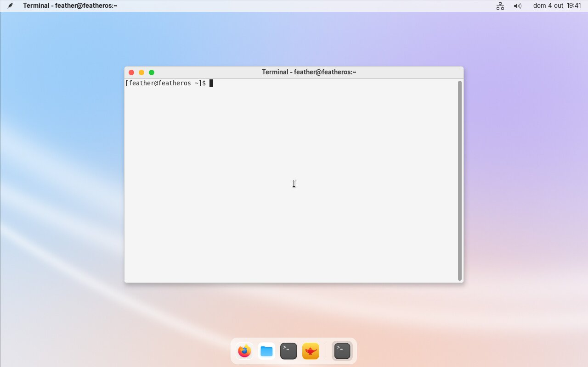
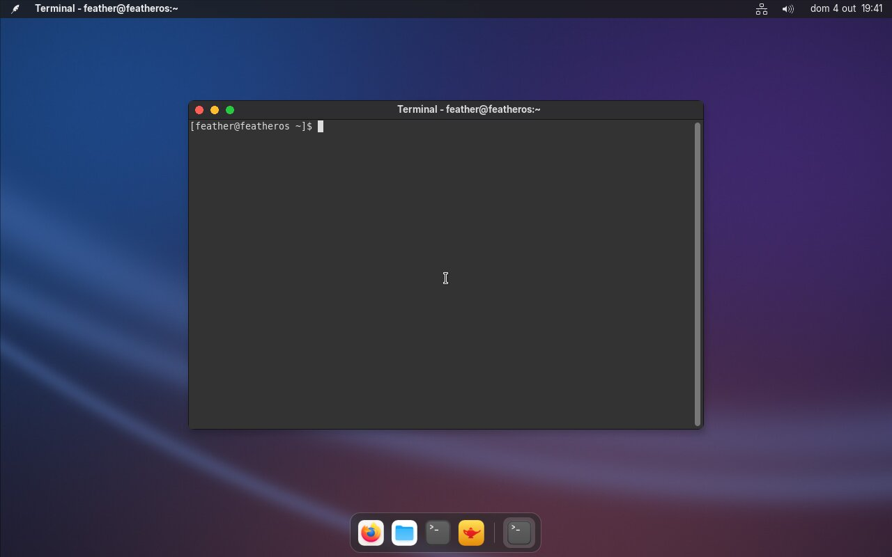
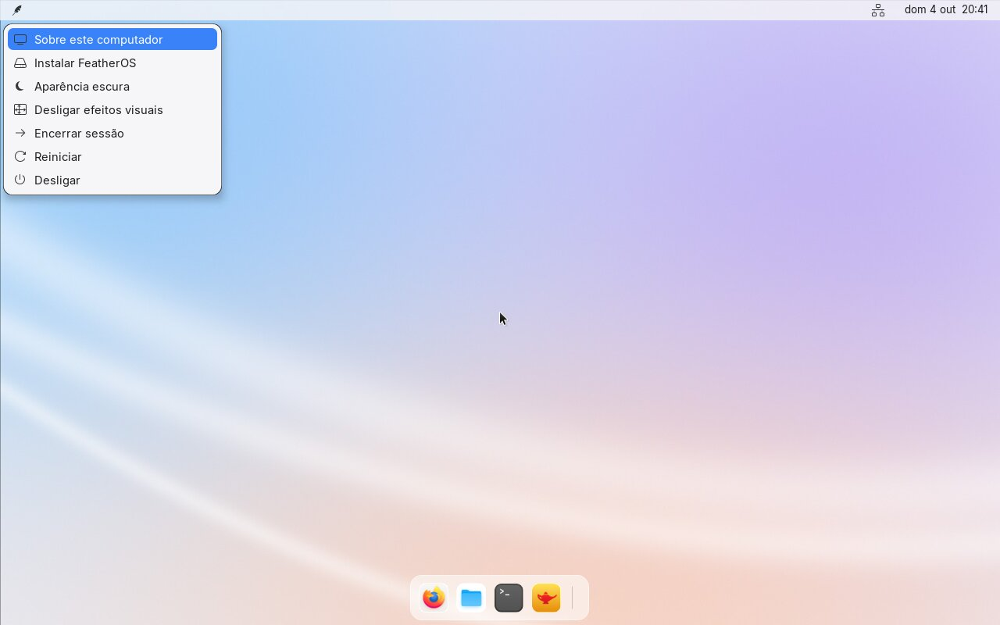
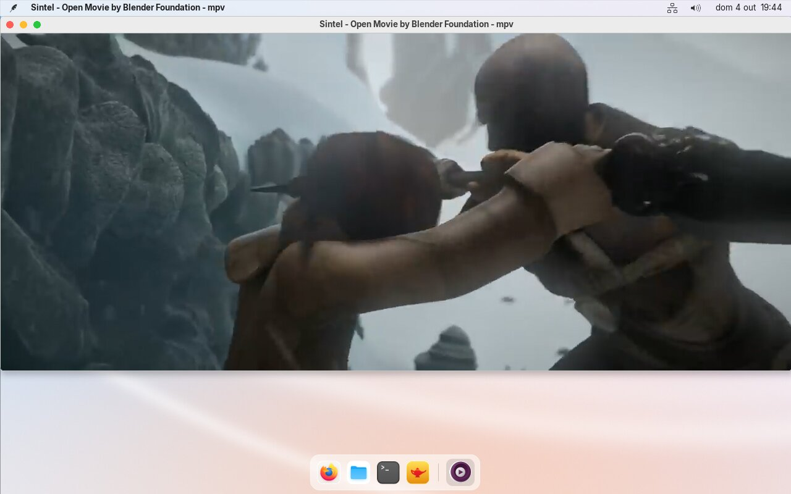
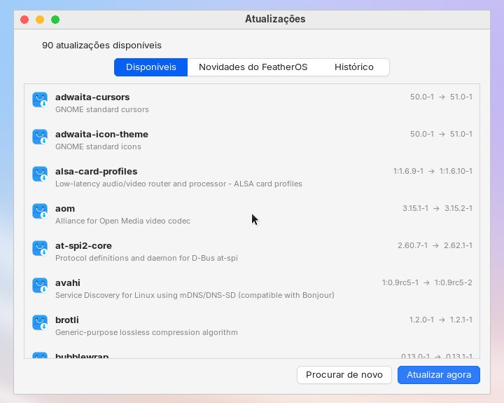

# FeatherOS

A very light, macOS-inspired Linux distribution built on Arch Linux. It is
made for one old laptop, the **Infoway Note W7410** (Core 2 Duo T6600, 3 GB
DDR2, Intel GMA 4500M, 5400 rpm HDD). It runs there every day, and it is
also tested in QEMU/GNOME Boxes.

- **Idle RAM after login: 138 MiB in use, 205 MB `free -m` "used"**
  (measured on the laptop; target < 250 MB)
- **Boot: about 20 s** from the kernel starting to a usable desktop on the
  HDD, plus firmware and GRUB (target < 30 s)
- **ISO: 1.2 GB.** It's a live USB and an offline installer in one.
- **Desktop:** X11 + Openbox, a tint2 top bar and an auto-hiding dock,
  Spotlight-style search, light and dark modes, and red/yellow/green window
  buttons.
- **Apps:** Firefox (tuned for 3 GB), mpv + yt-dlp (YouTube in H.264, 720p
  or lower), Geany, Neovim, git, gcc, Python, Node.js.
- **Updates:** a build machine on your network builds signed FeatherOS
  packages. The **Atualizações** app shows what's new and installs
  everything with one click, with no password and no prompts. You never
  have to reinstall.
- **UI language:** Portuguese (pt_BR). Keyboard layout: ABNT2.

| Light | Dark |
|---|---|
|  |  |
|  |  |

## Contents

1. [Build the ISO](#1-build-the-iso)
2. [Test in GNOME Boxes](#2-test-in-gnome-boxes)
3. [Install on the laptop](#3-install-on-the-laptop)
4. [Updates](#4-updates)
5. [Using FeatherOS](#5-using-featheros)
6. [Measured RAM, boot time and Wi-Fi](#6-measured-ram-boot-time-and-wi-fi)
7. [How it is built](#7-how-it-is-built)
8. [Troubleshooting](#8-troubleshooting)

## 1. Build the ISO

You need a Linux host (Ubuntu, Fedora, ...) with **podman** or **docker**,
about 15 GB of free disk space, and an internet connection. The build runs
inside an Arch Linux container, because `mkarchiso` only runs on Arch.

```sh
cp site.conf.example site.conf   # then set your build machine's name/IP
./build.sh                       # uses: sudo podman (or sudo docker)
```

`site.conf` holds what is specific to your network: the update server the
installer suggests. It is not committed.

`out/featheros-YYYY.MM.DD-x86_64.iso` is the result. The first build takes
about 15 minutes, 7 of them for the kernel on a 12-thread CPU. Later builds
only rebuild what changed: the kernel only when its `pkgver`/`pkgrel` changes.

Variants:

```sh
SUDO= ./build.sh           # rootless podman (works on Fedora)
ENGINE=docker ./build.sh   # force docker
./build.sh packages        # only build the signed update packages (repo/)
```

The first build also creates two keys in `signing/`: the **update-signing
key** and the **remote-access SSH key**. They have no passphrase and are
never committed. **Back up `signing/`.** Installed systems trust only these
keys; without them you would have to re-import new ones on the laptop by
hand.

## 2. Test in GNOME Boxes

1. Open GNOME Boxes, click **+**, choose **Install from File**, and select
   the ISO.
2. Set **Memory: 3 GB** so the VM matches the laptop, then create the VM.
3. It boots into the live desktop as the user `feather`. This user has no
   password and passwordless `sudo`.
4. Try the installer on the VM's own disk: feather menu (top-left) →
   **Instalar FeatherOS**.

Headless testing, used for the VM measurements below:

```sh
python3 scripts/vm-test.py out/featheros-*.iso --vga std --audio
python3 scripts/vm-test.py out/featheros-*.iso --throttle-mbps 30   # USB 2 speed
```

`vm-test.py` boots the ISO in QEMU/KVM (3 GB RAM, 2 cores, Core 2-class CPU
model), logs in over a serial console, and prints boot time and RAM figures.

- `--cmd` runs extra commands.
- `@shot file.png` takes a screenshot, and `@keys` / `@mouse` type and move
  the pointer.
- `--disk`, `--boot-disk` and `--uefi` test installs, and `--ssh-port`
  tests remote access.
- `--kernel linux-lts` has `mac80211_hwsim`, for Wi-Fi tests with a
  simulated access point.

## 3. Install on the laptop

1. Write the ISO to a USB stick (at least 2 GB). **Everything on the stick
   is erased.**
   ```sh
   lsblk                                     # find the stick, e.g. /dev/sdb
   sudo dd if=out/featheros-*.iso of=/dev/sdX bs=4M status=progress oflag=sync
   ```
   GNOME Disks ("Restore Disk Image") works too.
2. Boot the laptop from the stick (usually F12 or F11 at power-on). The boot
   menu has:
   - **FeatherOS**: the normal live session.
   - **FeatherOS (load to RAM)**: copies the system into RAM first. It starts
     slower, then runs fast, and the stick can be removed.
   - **FeatherOS (kernel Arch LTS)**: the stock Arch kernel, if some
     hardware doesn't work with the FeatherOS kernel.
3. Check Wi-Fi (click the network icon), sound and video before installing.
4. Feather menu → **Instalar FeatherOS**. The installer asks for:
   - the disk. **The whole disk is erased.**
   - your name, user name and password
   - the computer name
   - whether to log in automatically (default: no)
   - the update server: the build machine's name (`<hostname>.local`) or
     its IP address. The suggestion comes from `site.conf`.

   Then it copies the system from the stick, with no internet needed. That
   takes a few minutes on an HDD. BIOS/MBR or UEFI/GPT is detected
   automatically.
5. Remove the stick and reboot. GRUB waits 2 s with a hidden menu. Hold
   **Shift** or **Esc** during that time to choose the backup Arch LTS
   kernel.

What the installer sets up:

- `ext4` with `noatime`, and zram swap (no swap partition)
- an initramfs for both kernels with `autodetect`, so it only contains the
  laptop's own modules
- persistent logs capped at 50 MB
- Arch mirrors: the GeoIP mirror first, then the Brazilian mirrors
- the FeatherOS update repository and signing key

## 4. Updates

All of FeatherOS's own files are pacman packages: the `featheros-desktop`
package (scripts, themes, defaults), the kernel and the themes. Updates
therefore never need a reinstall, and your files and settings stay untouched.

**On the build machine:**

```sh
# change something in packages/featheros-desktop/files/ (or the kernel, ...)
./build.sh packages      # rebuilds and signs only what changed
./serve-updates.sh       # serves repo/ on port 8080 until Ctrl+C
```

**On the laptop:** feather menu → **Atualizar sistema**, or search
**Atualizações**. The app has three tabs:

- **Disponíveis:** every pending update, with its old and new version and a
  description. FeatherOS's own packages are listed first.
- **Novidades do FeatherOS:** the change notes from the build machine (its
  git log), with what's new since the last update marked.
- **Histórico:** what was installed, updated or removed, and when.

**Atualizar agora** installs everything at once, with no password and no
confirmation, and shows live progress. If a new kernel was installed, it
offers **Reiniciar agora**.



Details:

- **Arch and FeatherOS updates come together.** Arch packages come from the
  Arch mirrors and FeatherOS packages from the build machine. A new
  dependency added to `featheros-desktop` is installed automatically.
- **When the build machine is off,** the app leaves the FeatherOS repository
  out and still installs the Arch updates. A plain `sudo pacman -Syu` would
  stop instead, because one repository can't be reached.
- **Server address.** The laptop finds the build machine by name
  (`<hostname>.local`, via mDNS) or by IP. To change it:
  `sudo featheros-update-server 192.168.1.10`.
- **Firewall.** The build machine must accept TCP port 8080. Fedora
  Workstation's default zone already allows it. On Ubuntu with ufw enabled,
  run `sudo ufw allow 8080/tcp`.
- **Your settings.** Files under `/etc` that you edited are kept: the new
  version is saved as `.pacnew`. Per-user settings in `~/.config` are not
  overwritten either. Most of the look comes from system templates in
  `/usr/share/featheros`, so theme fixes still reach existing users.

## 5. Using FeatherOS

| Shortcut | Action |
|---|---|
| Super + Space | Search apps (Spotlight-style) |
| Super + Enter | Terminal |
| Super + E | Files |
| Super + Q | Close window |
| Super + Up / Down | Maximize / minimize |
| Super + Shift + P | Visual effects (shadows, rounded corners) on/off |
| Alt + Tab | Switch windows |
| Volume / brightness keys | Change volume / brightness |

- **Feather menu** (top-left): about this computer, update system (install
  from the live USB), light/dark appearance, effects on/off, remote access
  on/off, log out, restart, shut down. Restart and shut down need no
  password.
- **Dock:** stays visible while nothing covers it, and hides when a window
  overlaps it. Push the mouse to the bottom edge to bring it back over the
  window.
- **Top bar:** click the network icon for the Wi-Fi menu (click it again to
  close). On the volume icon, click to mute and scroll to change the level.
- **USB Wi-Fi adapters:** plug one in and FeatherOS switches it into Wi-Fi
  mode if needed (adapters that first appear as a "driver CD"), uses it, and
  turns the built-in card's radio off. Unplug it and the built-in card comes
  back. Realtek USB chips (rtw88, rtw89, rtl8xxxu) are supported.
- **YouTube:** search "Reproduzir vídeo da web", or run `featheros-play` with
  a link copied. It plays in mpv at H.264 ≤ 720p, using far less CPU and RAM
  than the browser. In Firefox, YouTube also gets H.264, because VP9/AV1 are
  disabled in its defaults.
- **Measuring:** `sudo featheros-mem` shows the real memory use per program
  (PSS), and `featheros-mem firefox` shows Firefox with all its tabs.
  `featheros-boottime` shows how long the last boot took.
- **Firefox:** WebGL is off to save about 130 MB. If a site needs 3D, set
  `webgl.disabled` to `false` in `about:config`.

### Remote access

Feather menu → **Ligar acesso remoto** starts an SSH server so the build
machine can run commands on the laptop, take screenshots (`maim`) and move
the mouse (`xdotool`). The box that appears shows the address to use.

- It accepts only the key in the build machine's `signing/ssh/`. Passwords
  and root logins are refused.
- It is off by default and switches off at every reboot. Switch it off
  sooner with **Desligar acesso remoto**.

From the build machine:

```sh
ssh -i signing/ssh/featheros_remote <user>@<laptop-ip>
```

## 6. Measured RAM, boot time and Wi-Fi

### On the laptop

Measured on the Infoway Note W7410 with kernel 6.18.58, after a clean boot
and one minute idle:

| | Result | Target |
|---|---|---|
| Memory in use (total − free − caches) | **138 MiB** | |
| `free -m` "used" (includes an SSH session) | **205 MB** | < 250, max 350 |
| Kernel (incl. initramfs) | 4.9 s | |
| Userspace to the login screen | 11.4 s | |
| X start → desktop ready | 4.0 s | |
| **Machine time, kernel → desktop** | **≈ 20 s** (+ firmware + GRUB 2 s) | < 30 s |

Two fixes found by measuring on the laptop itself:

- **GLX was costing 4.4 s per boot.** Xorg loaded Mesa (with LLVM) from the
  HDD for the GLX extension. GLX is now off, which brought Xorg's startup
  from 5.2 s to 2.2 s. mpv and Firefox use EGL instead.
- **The USB adapter sometimes had no interface after a reboot.** iwd's own
  interface creation failed with this adapter. iwd now uses the kernel's
  interface for Realtek USB adapters.

Wi-Fi, with the same router and room:

| | Built-in RTL8191SE | USB RTL8822CU |
|---|---|---|
| Download from the build machine | 0.3–0.4 MB/s | **3.2 MB/s** |
| Internet | 0.1–0.3 MB/s | **2.7 MB/s** (line speed) |
| Ping to the router | up to 2.3 s | **1.9 ms** |
| Receive link rate | 1–6 Mbit/s | 54–130 Mbit/s |

No driver setting rescued the built-in card. Power saving off made no
difference, and PCIe ASPM off broke the connection. Hence the USB adapter.

### Per component (VM)

Measured in the QEMU test VM. Per-component PSS needs root
(`sudo featheros-mem`); raw data in [docs/measurements.md](docs/measurements.md).

| Component | RAM (PSS) | Why it is there |
|---|---|---|
| Xorg | 40 MB | X11: more reliable than Wayland on the GMA 4500M |
| tint2 (top bar + dock) | 21 MB | about 50 MB lighter than Plank as the dock |
| Openbox | 13 MB | window manager (xfwm4: ~30 MB) |
| systemd + user manager | 11 MB | init |
| systemd-udevd | 5.6 MB | devices |
| systemd-networkd + resolved + timesyncd | 7.5 MB | network, DNS/mDNS, clock (NetworkManager + applet: ~40 MB) |
| journald + logind + dbus-broker | 7.4 MB | logs, sessions, IPC |
| featheros-dockd | 2.6 MB | the dock's auto-hide (event-driven) |
| bar status scripts | 2.2 MB | volume watcher (event-driven, no polling) |
| picom | 1.9 MB | shadows and rounded corners; off = 0 |
| iwd | 1.6 MB | Wi-Fi (wpa_supplicant + NetworkManager: more) |
| xsettingsd | 0.9 MB | live light/dark switching of open apps |
| PipeWire | 0 MB | socket-activated: starts with the first sound (20 MB then) |
| SSH server, display manager | 0 MB | off by default / none (tty login, then `startx`) |

### Applications (PSS including child processes, VM)

| App | RAM | Notes |
|---|---|---|
| xfce4-terminal | 59 MB | Alacritty measured 107 MB |
| Geany (1 file) | 57 MB | Lite XL measured 108 MB |
| mpv, YouTube 720p H.264 | 160–190 MB | |
| Firefox, claude.ai open | 1078 MB | 1196 MB with Arch defaults; ~600 MB with an empty tab |

### Sizes

| | |
|---|---|
| ISO | 1.2 GB (of which the backup Arch LTS kernel is about 160 MB) |
| FeatherOS kernel | 167 modules (Arch linux-lts: 6227) |

## 7. How it is built

```
build.sh                 build the ISO (or packages only) in an Arch container
serve-updates.sh         serve repo/ (packages + change notes) to the laptop
site.conf.example        per-network settings (copy to site.conf)
archiso/                 archiso profile: package list, boot menus, live-only files
  airootfs/              live session plumbing + the installer (featheros-install)
packages/
  featheros-desktop/     FeatherOS itself: files/ mirrors /, dockd/ is the dock
                         helper (C); PKGBUILD lists every app as a dependency
  whitesur-*-theme/      WhiteSur GTK/icons/cursors (Apple logos removed)
kernel/
  linux-featheros/       kernel PKGBUILD (from Arch linux-lts) + generated config
  featheros.config       config overrides (each one explained)
  modules-*.txt          module lists for localmodconfig
hardware/                lspci / lsusb / lsmod from the laptop
artwork/                 logo SVGs, wallpaper + Openbox theme generators
scripts/                 build steps, kernel config, VM test harness
docs/                    measurements, screenshots
```

**Kernel.** The kernel is Arch's `linux-lts` (6.18 LTS) config, run through
`make localmodconfig` with the union of three module lists: the laptop's
`lsmod`, the VM's `lsmod`, and `modules-extra.txt` (live boot, filesystems,
iwd crypto, virtio). Modules in `modules-exclude.txt` are dropped, then
`featheros.config` is applied:

- no debug info or tracing
- `NR_CPUS=8` and no NUMA
- transparent hugepages off. THP raised `min_free_kbytes` to about 67 MB.
- the BFQ disk scheduler built in
- every Realtek HDA codec. Since 6.17 the Realtek codec module is split per
  chip; the laptop's is an ALC272.
- the Realtek USB Wi-Fi drivers

To change it, edit those files, bump `pkgrel` in
`kernel/linux-featheros/PKGBUILD`, and run `./build.sh packages` to get a
kernel update. For a new LTS release, take `config.x86_64`, patch 0001 and
the checksums from Arch's
[linux-lts](https://gitlab.archlinux.org/archlinux/packaging/packages/linux-lts).

**Packages.** `featheros-desktop` gets a new date-based version whenever
anything under `packages/featheros-desktop/` changes. The themes and kernel
use normal `pkgver`/`pkgrel`.

**Root without passwords.** A few actions run as root without a password,
for users in `wheel`. Each is an exact command in `/etc/sudoers.d/20-*`:

- restart, shut down and suspend
- remote access on/off
- `update-system check|apply`

**License.** FeatherOS's own files are GPL-3.0-or-later (see `LICENSE`).
The FeatherOS logo, wallpapers and Openbox themes are original. WhiteSur is
MIT (GTK) and GPL-3.0 (icons, cursors). In the WhiteSur build, the Apple
logo is replaced by the feather, the Finder-face file manager icon by a
folder, and the Safari and iCloud icons are removed. No Apple fonts are
used: the UI font is Inter.

## 8. Troubleshooting

- **The desktop doesn't start (black screen, or back to a text login).**
  Log in and look at `~/.local/share/xorg/Xorg.0.log`. On the GMA 4500M,
  FeatherOS uses the `intel` X driver (SNA). To try the generic modesetting
  driver instead, run `sudo rm /etc/X11/xorg.conf.d/20-gpu.conf`, then
  `startx`.
- **An app complains about GLX.** GLX is off to speed up boot. To turn it
  back on, run `sudo rm /etc/X11/xorg.conf.d/10-featheros-no-glx.conf`,
  then log out and in.
- **Windows draw badly or dragging feels slow.** Turn effects off with
  Super + Shift + P. The choice is remembered.
- **Wi-Fi isn't found.** Check `ip link` and `lsmod | grep -E "rtl|rtw"`. Try
  the **kernel Arch LTS** entry. If it works there, a module is missing from
  the FeatherOS kernel: add it to `kernel/modules-extra.txt` and rebuild.
- **No sound.** Run `alsamixer` (F6 selects the card) and unmute Master and
  Speaker.
- **Updates can't reach the build machine.** Make sure `./serve-updates.sh`
  is running there. On the laptop, try
  `curl http://<hostname>.local:8080/x86_64/featheros.db -o /dev/null`. If
  the name doesn't resolve, use the IP:
  `sudo featheros-update-server 192.168.1.10`.
- **"signature from FeatherOS updates is unknown trust".** The packages were
  signed with a different key than the one the laptop trusts, for example
  because `signing/` was lost. Re-import the key:
  ```sh
  sudo pacman-key --add /usr/share/featheros/keys/featheros.asc
  sudo pacman-key --lsign-key featheros@localhost
  ```
  Use the new `featheros.asc` from the build machine, copied over.
